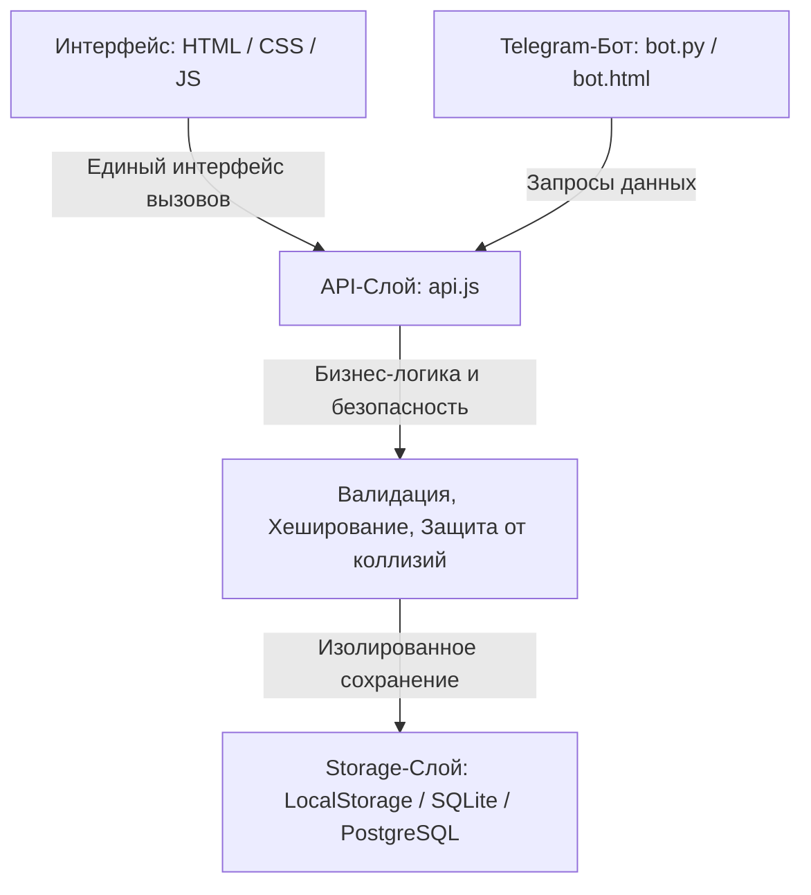

# 🏆 Портал учёта достижений лицея

> **Проект команды 9Б класса для школьного хакатона (группа 9–11 классы).**  
> Комплексная веб-платформа для учёта академических и внеучебных успехов учеников по **физике, математике и информатике**, проектной деятельности и волонтёрству. Включает личный кабинет ученика, панель администратора/учителя, систему верификации с защитой от коллизий, динамический рейтинг, генерацию официального PDF-портфолио, ИИ-помощника, систему бейджей и Telegram-бота.

---

## ⚡ Быстрый запуск (без сервера)

Проект полностью автономен и открывается **в любом современном браузере без установки Node.js или веб-серверов**:

1. Откройте файл `index.html` двойным кликом мыши.
2. Для тестирования используйте готовые аккаунты:
   * 🔑 **Администратор лицея:** логин `admin` / пароль `admin2026`
   * 👨‍🎓 **Ученики (команда 9Б):**
     * `Rail` / пароль `2026` (Гумеров Раиль, лидер рейтинга)
     * `Amir` / пароль `2026` (Якубов Амир)
     * `Islam` / пароль `2026` (Фаррахов Ислам)
     * `Samir` / пароль `2026` (Биктагиров Самир)
     * `Radislav` / пароль `2026` (Авдошин Радислав)
     * `Samat` / пароль `2026` (Яруллин Самат)
   * 👩‍🎓 **Другие классы:** `Aliya` (10А), `Timur` (11Б), `Kamila` (9А) — пароль `2026`.
3. Также доступна кнопка **«Создать аккаунт»** для мгновенной регистрации нового ученика.
4. **Кнопка «Сбросить демо»** в шапке в любой момент восстанавливает исходную базу данных.

---

## 📁 Структура проекта

```text
├── index.html            # Авторизация и регистрация с разделением ролей
├── student.html          # Личный кабинет ученика (прогресс, подача заявок, PDF, ИИ, бейджи)
├── admin.html            # Админ-панель (модерация заявок, добавление достижений, CSV-экспорт)
├── rating.html           # Интерактивный рейтинг с фильтрами по классам, предметам и периодам
├── bot.html              # Интерактивный веб-симулятор Telegram-бота для защиты
├── css/
│   └── style.css         # Единая адаптивная дизайн-система (графит + лицейское золото)
├── js/
│   ├── api.js            # API-слой: CRUD, валидация, расчет баллов, геймификация, ИИ-помощник
│   ├── auth.js           # Управление сессиями, защита роутов (Route Guard)
│   ├── storage.js        # Изолированный слой персистентности (localStorage)
│   └── csv.js            # Экспорт отчётов в формате CSV с поддержкой UTF-8 BOM для Excel
├── data/
│   └── seed.js           # Начальные тестовые данные (10 пользователей, 14 достижений, матрица баллов)
├── database/
│   ├── schema.sql        # Реляционная схема базы данных (PostgreSQL) с индексами и VIEW
│   └── init_sqlite.py    # Скрипт создания локальной базы SQLite для бэкенда
└── bot/
    └── telegram_bot.py   # Полноценный Telegram-бот на Python (работает без сторонних библиотек)
```

---

## 🏛 Архитектура решения

Архитектура построена по принципу **трёхзвенного разделения (3-Tier Clean Architecture)**:



### Преимущество предложенной архитектуры:
- **Zero-Dependency Frontend:** Интерфейс не обращается к хранилищу напрямую. Все вызовы идут через `api.*`. При развёртывании промышленного сервера на Node.js/Python/Go меняется только реализация методов в `api.js` (замена на стандартный `fetch()`), а верстка и логика UI остаются неизменными.
- **Безопасность:** Пароли не хранятся в открытом виде (используется хеширование `cyrb53` на клиенте и `SHA-256` в серверной схеме).
- **Ролевая защита:** На уровне `Auth.guard()` и в ядре API методы отклоняют неавторизованные действия (ученик не может подтвердить заявку, даже обратившись к консоли).

---

## 🗄 Схема базы данных

Реляционная модель спроектирована с учётом третьей нормальной формы (3NF):

```sql
-- Таблица пользователей
users (
    id VARCHAR(36) PRIMARY KEY,
    login VARCHAR(50) UNIQUE NOT NULL,
    password_hash VARCHAR(255) NOT NULL,
    full_name VARCHAR(150) NOT NULL,
    class_name VARCHAR(10),             -- "9Б", "10А" (NULL для админов)
    role VARCHAR(20) NOT NULL,          -- 'student' | 'admin'
    telegram_id BIGINT UNIQUE
);

-- Таблица достижений
achievements (
    id VARCHAR(36) PRIMARY KEY,
    user_id VARCHAR(36) REFERENCES users(id),
    title VARCHAR(255) NOT NULL,
    category_code VARCHAR(30),          -- physics, math, informatics, project, volunteering
    type_code VARCHAR(30),              -- olympiad, competition, conference, project, exam
    level VARCHAR(20),                  -- school, city, region, federal
    result VARCHAR(20),                 -- winner, prize, participant
    points INT NOT NULL,                -- начисляется по утверждённой матрице баллов
    event_date DATE NOT NULL,
    file_url TEXT,                      -- ссылка на подтверждающий диплом/грамоту
    status VARCHAR(20) NOT NULL,        -- 'pending' | 'approved' | 'rejected'
    verified_by VARCHAR(36) REFERENCES users(id),
    verified_at DATE,
    rejection_comment TEXT              -- обязателен при отклонении
);

-- Журнал аудита верификации (защита от коллизий)
verification_audit_log (
    id SERIAL PRIMARY KEY,
    achievement_id VARCHAR(36) REFERENCES achievements(id),
    admin_id VARCHAR(36) REFERENCES users(id),
    action VARCHAR(20),
    comment TEXT,
    created_at TIMESTAMP
);
```

---

## ⚖️ Продуманная ролевая модель и краевые случаи

1. **Что если два администратора попытаются подтвердить одно достижение одновременно?**
   * *Решение:* На уровне API и БД статус проверяется перед записью (`optimistic locking`). Если статус уже отличен от `pending`, повторная попытка блокируется ошибкой `Уже подтверждено другим администратором`. Все действия протоколируются с фиксацией ID администратора и даты.
2. **Что если ученик указывает чужой диплом или фальсифицирует баллы?**
   * *Решение:* Ученик не вводит баллы вручную — система рассчитывает их автоматически строго по типу, уровню и результату. Баллы попадают в общий рейтинг **только после верификации учителем**. В заявке прикрепляется прямая ссылка на скан диплома. При отклонении администратор обязан указать причину (например, *«Диплом отсутствует в официальном протоколе»*).
3. **Защита от SQL-инъекций и XSS:**
   * Все пользовательские строки проходят обязательное экранирование через функцию `esc()` перед вставкой в DOM. В серверном SQL-коде используются параметризованные запросы (`prepared statements`).

---

## 🤖 Telegram-бот лицея

В проект включено два дополняющих друг друга решения для работы с ботом:

1. **Интерактивный симулятор в браузере (`bot.html`):**
   * Позволяет жюри прямо на презентации протестировать все сценарии бота без интернета, установки Python и сторонних сервисов!
   * Синхронизирован с единой базой данных портала: заявка, поданная в боте, мгновенно появляется в админ-панели.
2. **Серверный бот на чистом Python (`bot/telegram_bot.py`):**
   * Реализован на стандартных модулях `urllib.request` и `json` (работает на любом Python 3 без `pip install`).
   * Поддерживает привязку аккаунта, просмотр личных баллов по предметам, топ-10, пошаговый мастер подачи заявки и советы ИИ.
   * Для запуска с реальным токеном:
     ```bash
     set TELEGRAM_BOT_TOKEN=ваш_токен_от_BotFather
     python bot/telegram_bot.py
     ```

---

## 🌟 Дополнительные возможности (на максимальный балл)

* 📄 **Генерация официального PDF-портфолио:** кнопка «Скачать портфолио» формирует чистый документ с разбивкой по предметам, готовый к печати или сохранению в PDF (Ctrl+P).
* 🤖 **ИИ-помощник лицеиста:** алгоритм анализирует профиль ученика по предметам STEM (физика, математика, IT), рассчитывает отставание от порога лицейской стипендии и даёт персонализированные рекомендации.
* 🎖 **Геймификация:** 4 уровня прогресса («Новичок» → «Активист» → «Мастер наук» → «Легенда лицея») и система бейджей («Юный Ньютон», «Архимед», «Кодер лицея», «Доброе сердце»).
* 📊 **Экспорт отчётов:** выгрузка таблицы всех достижений в формате CSV с корректной кодировкой для MS Excel.

---

## ⏱ Сценарий живой демонстрации для жюри (60 секунд)

1. **[00-15 сек] Вход и личный кабинет ученика (`student.html`):**
   * Входим под учеником `Rail` (пароль `2026`).
   * Показываем прогресс, бейджи и совет ИИ-помощника: *«До стипендии не хватает 10 баллов»*.
   * Нажимаем **«Скачать портфолио (PDF)»** — демонстрируем готовый документ.
2. **[15-30 сек] Подача заявки через Telegram-бота (`bot.html`):**
   * Открываем вкладку бота. Нажимаем «📊 Мой рейтинг» и «➕ Подать достижение».
   * Отправляем заявку на городскую олимпиаду по математике (призёр).
3. **[30-45 сек] Верификация администратором (`admin.html`):**
   * Входим под `admin` (пароль `admin2026`).
   * В таблице «Заявки на верификацию» видим новую заявку с прикрепленным дипломом.
   * Нажимаем зелёную кнопку **«✓ Подтвердить»**.
4. **[45-60 сек] Рейтинг лицея (`rating.html`):**
   * Открываем рейтинг. Показываем пересчёт баллов в реальном времени.
   * Демонстрируем фильтры по предметам (Физика / Математика / Информатика) и классам.
   * В админке скачиваем итоговый CSV-отчёт.

---

## 🎤 План питча на защиту проекта (5 минут)

* **1 минута — Проблема:** Сложность ручного сбора грамот школьников, непрозрачность начисления баллов для профильных классов и стипендий, отсутствие единой картины успехов ученика.
* **1.5 минуты — Наше решение:** Портал достижений лицея с чёткой матрицей баллов, автоматическим портфолио и интеграцией с Telegram.
* **1.5 минуты — Живое демо:** Демонстрация связки «Ученик → Telegram-бот → Админ → Рейтинг лицея».
* **1 минута — Архитектура и масштабирование:** Готовая схема БД PostgreSQL, защита от коллизий, перспектива интеграции с электронным дневником школы и сервисом Госуслуг.
